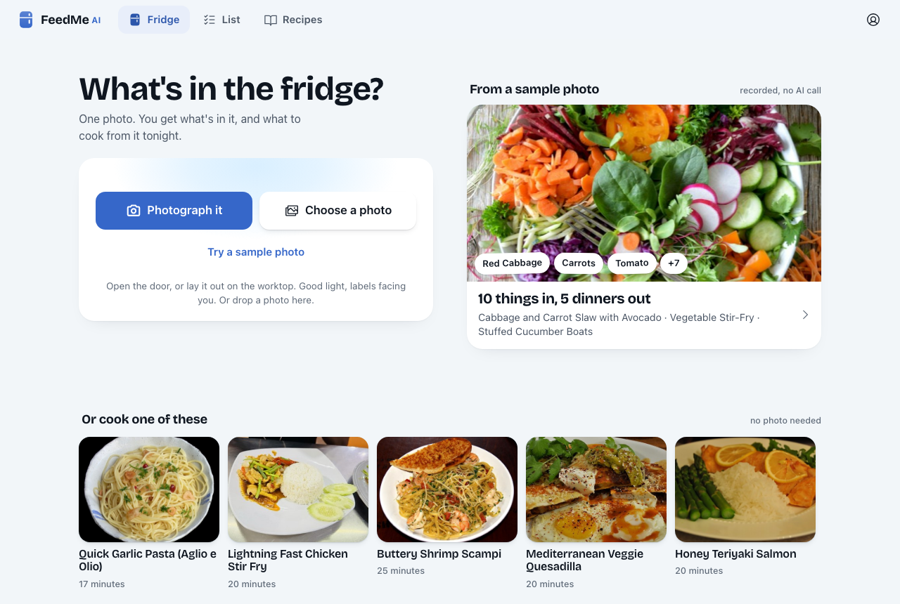
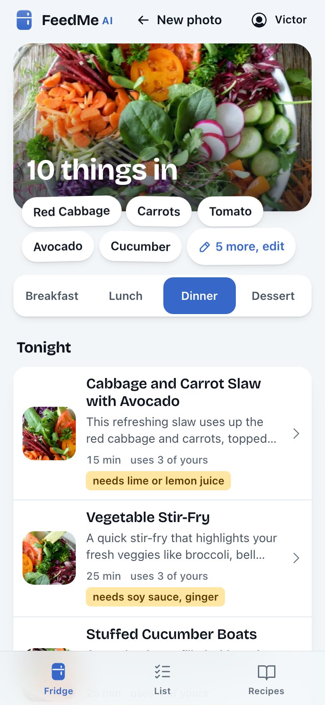
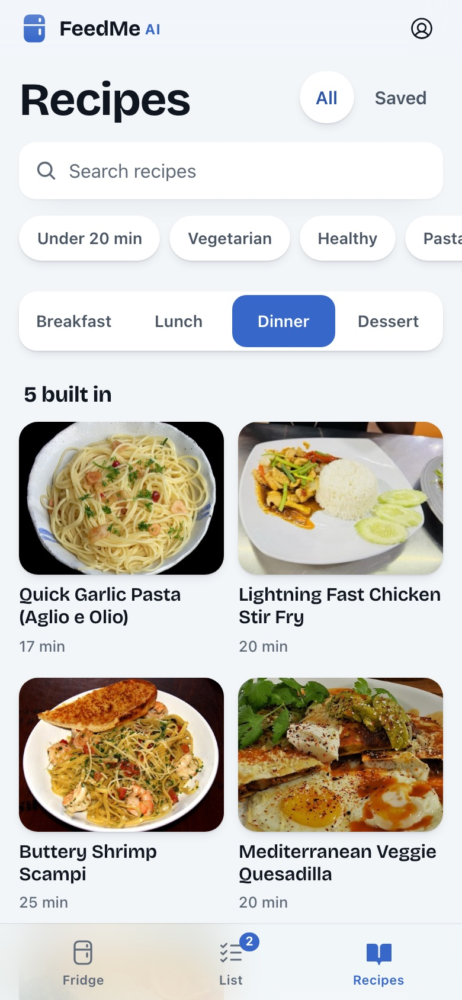
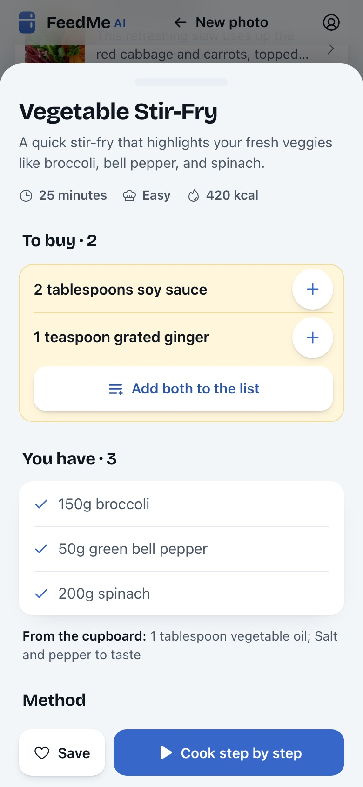

# FeedMe AI

Take one photo of your fridge and get back a list of what's in it and what you could cook from it tonight. A phone-first web app for people who stare into the fridge at 6pm.

**Site: [feedmeai.victorsaly.com](https://feedmeai.victorsaly.com)** · **App: [feedmeai.victorsaly.com/app](https://feedmeai.victorsaly.com/app/)** (installable from the browser)



<p>
  
  
  
</p>

## What it offers

- **Try it first.** "Try a sample photo" opens a recorded run with no AI call, so you can see a result before giving a photo.
- **Photo to ingredients.** Take or upload a photo; the app lists what it can see, with rough amounts. The list is editable before you ask for ideas.
- **Dinner ideas from what you have.** A short list of dishes for the meal you pick (breakfast, lunch, dinner or dessert, defaulting to the time of day), sized to how much of each ingredient you have. Open any one for the full recipe.
- **Recipe sheet and cook mode.** A recipe opened from your photo leads with what you need to buy, with one button to add it all to the list, then what you already have. Method, time, difficulty and an estimated per-serving nutrition figure follow. "Cook step by step" shows one step at a time with the amounts that step needs, offers a timer where a step names a time, and keeps the screen awake where the browser allows it.
- **Real recipes and videos (signed in).** Published recipes from [Spoonacular](https://spoonacular.com/food-api) that use the most of what's in your photo, mixed in with the AI's ideas and credited to their source. Recipes also show a cooking video where one is found.
- **Recipes tab.** Built-in recipes with real photos, a search box and filter chips (time, diet, dish type, cuisine), plus Spoonacular results when signed in. Saved recipes are a switch inside it.
- **Recent.** Each fridge photo you run, with its list, ideas and opened recipes, is kept on your device and can be reopened without a network call.
- **Saved.** Save recipes on your device with no account; sign in and they follow you between devices. Your fridge photo stays on the device; only the recipe is stored.
- **Shopping list.** Add missing ingredients from any recipe with one tap, or type your own. The list is kept on your device, so it needs no account and no signal; sign in and it follows you between devices. Signed in, it can also find the cheapest shop for the whole list (tested in the UK only).
- **Works offline once installed.** A service worker caches the app so the list still opens in the supermarket.
- **Demo mode.** Without an AI key on the backend, the app still runs: the photo step shows a sample list and ideas come from the built-in recipes, labelled as such.

Sign-in uses the shared victorsaly.com account (Google). Nothing needs it except shop prices and the wider recipe search: signed out, the photo-to-recipe flow, Recipes, Recent, Saved and the shopping list all work on the device.

## How it works

- The front end is static, on GitHub Pages, and holds no API keys. The product site is plain HTML at the root (`index.html`, `privacy/`, `support/`); the app is a React app at `/app/` (`app/index.html`). One build makes both.
- `worker/` is a Cloudflare Worker (`feedmeai-api`) that does everything needing a secret: OpenAI vision and text calls (`gpt-4o-mini`), an optional generated "suggested look" image for new dishes (signed in only), Spoonacular recipe search, YouTube video lookup and Google Shopping search via SearchAPI. What each person may do is set by a plan (`worker/src/plan.js`): photos read a day, shop price checks, and generated pictures, counted separately for a free tier and a paid one that is not on sale yet. It also stores the shopping list in Cloudflare D1.
- `workers/favorites-api/` is a second small Worker that stores saved recipes in the same D1 database, keyed by account.
- Both Workers verify the session token against the shared auth API on each request.

## Tech stack

React 19, TypeScript, Vite, Tailwind CSS, Radix UI / vaul, Cloudflare Workers + D1, OpenAI, Spoonacular, SearchAPI, YouTube Data API.

## Run locally

Requires Node.js 22+.

```bash
git clone https://github.com/victorsaly/feedmeAI.git
cd feedmeAI
npm install
npm run dev        # the site at http://localhost:5173, the app at http://localhost:5173/app/
```

By default the app talks to the deployed Worker, so no `.env` is needed. To point it at your own Worker (for example `npx wrangler dev` in `worker/`), set `VITE_FEEDME_API` in `.env` (see `.env.example`).

Other scripts:

```bash
npm run build      # type build, Vite build, then generate the service worker
npm run preview    # serve the production build on port 4173
npm run lint
npm run type-check
npm test           # unit tests: the kitchen, the list, shop prices, ingredient sorting
npm run test:e2e   # the sample path end to end, on the built app, with the network refused
```

The end-to-end test needs a browser once: `npx playwright install chromium`.

### iPhone app

The iPhone app is this same web app inside a native shell ([Capacitor](https://capacitorjs.com)); the Xcode project is in `ios/`. It needs Xcode.

```bash
npm run ios          # build the web app, copy it into the project, open Xcode
npm run ios:sync     # the same, without opening Xcode
npm run icons        # redraw every icon and the share image from the logo
npm run ios:assets   # regenerate the app icon and splash from assets/
```

In the app, the two photo buttons use the system camera and photo library, and cooking keeps the screen awake. Signing in is not available in the app yet.

### Backend

```bash
cd worker
npx wrangler secret put OPENAI_API_KEY
npx wrangler secret put SPOONACULAR_KEY
npx wrangler secret put SEARCHAPI_KEY
npx wrangler secret put YOUTUBE_API_KEY   # optional
npx wrangler deploy
```

`workers/favorites-api/` deploys the same way with `npx wrangler deploy` from its folder. Each Worker's `wrangler.toml` holds its D1 binding and allowed origins.

Pushing to `main` runs lint and both sets of tests, then builds and deploys the front end to GitHub Pages (`.github/workflows/deploy.yml`).

## Project structure

```
index.html             the product site's home page; privacy/ and support/ beside it
app/index.html         the app's page shell
src/
  site/site.css        the product site's styles
  App.tsx              the single page and its stages (start, list, ideas, recipe, cook)
  components/          PhotoPicker, HaulList, IdeaList, IdeaSheet, CookScreen,
                       RecipesTab, SavedList, ListTab, TabBar, Account, ...
  lib/
    kitchen.ts         identify -> suggest -> expand, with the offline fallback
    spoonacular.ts     real recipes and videos via the Worker
    history.ts         Recent, kept in localStorage
    sample.ts          the recorded sample run
    pantry.ts          have / to buy / cupboard, and what each cooking step needs
    favorites.ts       Saved: on the device, and via favorites-api when signed in
    list.ts            shopping list: on the device, synced when signed in
    todos.ts           the account's copy of the list, via feedmeai-api
    shopping.ts        where-to-buy search and shop comparison
    account.ts         sign-in session
    native.ts          the few places the iPhone app differs: camera, screen awake
  data/                built-in recipes and search categories
  styles/flow.css      the app's look (described in DESIGN.md)
e2e/                   the end-to-end test
worker/                feedmeai-api (AI, recipes, shopping, todos)
workers/favorites-api/ saved recipes
public/                icons, manifest, og image, recipe photos (credits in public/food/CREDITS.md)
ios/                   the iPhone app's Xcode project (Capacitor)
assets/                the sources the app icon and splash are generated from
```

## License

MIT. See [LICENSE](LICENSE).

Made by [Victor Saly](https://victorsaly.com).
